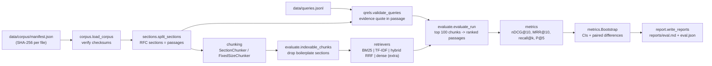

# retrievallab

Retrieval-augmented generation (RAG) systems are usually tuned by reading a few answers and
deciding they look better. retrievallab measures retrieval instead: it chunks a fixed,
checksummed corpus (18 IETF RFCs on OAuth 2.0), runs several retrievers over 71 labelled
queries, and reports recall@k, precision@k, MRR and nDCG@10 with bootstrap confidence
intervals, so a change to chunking or ranking is accepted only when the numbers support it.

## Why it matters

The retriever caps what a RAG system can answer: if the passage that holds the answer is not
in the top k, the generator never sees it. Retrieval changes are cheap to try (chunk size,
BM25 versus embeddings, hybrid fusion) and hard to judge by eye, because a change that helps
three queries you looked at can hurt twenty you did not. Judging them needs a fixed corpus,
labels written before the comparison, metrics with known definitions, and an estimate of how
much of a difference is noise. On 71 queries a 0.02 change in nDCG is usually noise; this
harness says so instead of leaving it to the reader.

## What it does

- **Pinned corpus.** `data/corpus/` holds 18 unmodified RFC text files and a `manifest.json`
  with each file's SHA-256. Loading fails on any mismatch. Licence: IETF Trust Legal
  Provisions, see [`data/corpus/LICENSE-CORPUS.md`](data/corpus/LICENSE-CORPUS.md).
- **Section parser.** `sections.split_sections` splits each RFC into numbered sections, which
  are the *passages* that labels refer to (`rfc6749#4.1.2`). A test checks every entry in each
  RFC's own table of contents is parsed.
- **Chunkers with stable ids and offsets.** `FixedSizeChunker` (sliding windows with overlap,
  cut at whitespace) and `SectionChunker` (paragraph packing that never crosses a section).
  Chunk ids are `doc@start-end`, and `doc.text[start:end] == chunk.text` always holds.
- **Retrievers behind one interface** (`retrievers/base.py`): BM25 written from the formula,
  TF-IDF cosine, reciprocal rank fusion (RRF) of the two, and an optional dense retriever
  (`sentence-transformers`) installed only with the `dense` extra.
- **Labelled queries.** 71 queries with 152 graded passage labels, each with a quoted phrase
  that must appear in the labelled passage; `retrievallab verify` checks every quote. How the
  labels were made, and what they cannot tell you, is in
  [`docs/LABELS.md`](docs/LABELS.md).
- **Metrics and statistics.** Recall@k, precision@k, MRR@10 and nDCG@10, unit-tested against
  hand-computed cases; percentile bootstrap intervals over queries; Holm-corrected paired
  bootstrap comparisons for each
  run against the baseline.
- **Reports with citations.** `retrievallab eval` writes `reports/eval.md` and
  `reports/eval.json`. The JSON lists, for every query and run, the top passages with document
  id, section number, section title and character offsets. Output is byte-for-byte
  deterministic, and CI regenerates it and fails if it differs from the committed copy.

## Architecture



Evaluation is at passage level. A section chunk is credited to its section. A fixed window is
credited to every section it overlaps by at least 100 characters or contains completely
(`sections.credited_sections`), so a short labelled section inside a window can be found. Each
credited passage takes its own rank in the passage list (a window credited to three sections
fills three of the top 10 slots), duplicates keep their best rank, and that list is scored.
This is what lets a 1000-character sliding window and a section-aligned chunk be compared on
the same labels. The report also lists, per chunker, how many labels are reachable at all; with
the current rule all 152 are reachable under both default chunkers, and a test enforces it.

## Technology choices

| Choice | Why | Cost |
| --- | --- | --- |
| Pure-Python core, no runtime dependencies | BM25, TF-IDF and RRF are each under 100 lines; writing them keeps every formula visible and testable, and `uv sync` installs nothing heavy | Slower than Lucene or numpy; fine for about 1,200 chunks, not for millions |
| Own BM25 rather than `rank_bm25` | Pinning exact values in tests needs a fixed formula (Lucene's non-negative IDF variant, documented in `bm25.py`) | Must be maintained here |
| IETF RFCs as the corpus | Openly redistributable in full (IETF TLP 3.c(i)), technical, stable, with numbered sections that make citations meaningful | One domain (OAuth); results do not transfer to other text |
| Passage = RFC section | Labels survive any change of chunker, and a section is what a reader would cite | Some sections are long; a hit anywhere in them counts |
| Percentile bootstrap over queries, Holm-corrected verdicts | No normality assumption for bounded, skewed per-query scores; paired resampling removes query difficulty from comparisons; Holm controls the family-wise error over the 15 comparisons | 71 queries give wide intervals, and Holm is conservative |
| `sentence-transformers` only as an extra | Torch and model downloads would make CI slow and network-dependent | Dense numbers are not in the committed report (see Limitations) |

## Installation

Requires Python 3.12 and [uv](https://docs.astral.sh/uv/).

```bash
git clone <this repository> retrievallab
cd retrievallab
uv sync --locked
```

Optional dense retriever (downloads PyTorch, and a model on first use):

```bash
uv sync --locked --extra dense
```

## Quick start

```bash
uv run retrievallab verify   # corpus checksums and every label's evidence quote
uv run retrievallab eval     # writes reports/eval.md and reports/eval.json, about 3 s
```

## Examples

Search with citations (document, section, character offsets into the file):

```console
$ uv run retrievallab search "how long can an authorization code be used" --method bm25 -k 1
1. rfc6819 section 3.3 "Refresh Token"
   chars 29951-30662  chunk rfc6819@29951-30662  score 9.2100
   1. The resource owner and user agent safely deliver the authorization "code" to the client
   ...
```

That top hit is a miss: the answer is RFC 6749 section 4.1.2 ("A maximum authorization code
lifetime of 10 minutes is RECOMMENDED"), which shares few words with the question. Query
`q001` is one of four that no run answers in the top 10, listed at the end of
`reports/eval.md`.

Compare other configurations (every flag is optional):

```bash
uv run retrievallab eval --chunkers section:800,section:1500,fixed:500:100 \
    --methods bm25,hybrid --baseline bm25/section:1500 --out reports/tmp
uv sync --locked --extra dense
uv run retrievallab eval --methods bm25,dense,hybrid-dense --chunkers section --out reports/tmp
```

## Results

Produced by `uv run retrievallab eval` (defaults: section chunks of at most 1500 characters,
fixed windows of 1000 characters with 200 overlap, top 100 chunks per query, 10,000 bootstrap
resamples, seed 0). Mean over 71 queries with 95% confidence intervals. "Reachable labels"
is the number of labels some indexed chunk is credited to, which caps recall. The full report,
with every comparison, is [`reports/eval.md`](reports/eval.md).

| Run | Chunks | Reachable labels | nDCG@10 | MRR@10 | Recall@10 | Recall@5 | P@5 |
| --- | ---: | ---: | --- | --- | --- | ---: | ---: |
| bm25/section | 1156 | 152/152 | 0.602 [0.532, 0.672] | 0.620 [0.533, 0.707] | 0.768 [0.692, 0.840] | 0.624 | 0.242 |
| tfidf/section | 1156 | 152/152 | 0.516 [0.443, 0.591] | 0.539 [0.451, 0.628] | 0.689 [0.607, 0.770] | 0.547 | 0.217 |
| hybrid/section | 1156 | 152/152 | 0.589 [0.516, 0.660] | 0.604 [0.513, 0.692] | 0.750 [0.676, 0.820] | 0.595 | 0.231 |
| bm25/fixed | 1291 | 152/152 | 0.565 [0.488, 0.639] | 0.593 [0.495, 0.687] | 0.717 [0.634, 0.798] | 0.538 | 0.211 |
| tfidf/fixed | 1291 | 152/152 | 0.537 [0.452, 0.618] | 0.572 [0.473, 0.669] | 0.668 [0.577, 0.754] | 0.523 | 0.203 |
| hybrid/fixed | 1291 | 152/152 | 0.551 [0.473, 0.629] | 0.585 [0.486, 0.680] | 0.692 [0.606, 0.775] | 0.538 | 0.208 |

What the paired comparisons against `bm25/section` support after Holm correction over all 15
comparisons (the report also shows uncorrected verdicts):

- TF-IDF on section chunks is worse than BM25 on nDCG@10 (-0.086, 95% CI [-0.128, -0.046],
  Holm p < 0.0001) and Recall@10 (-0.079 [-0.134, -0.030], Holm p = 0.0028). Its MRR@10
  difference (-0.081) is not significant after correction (Holm p = 0.06).
- Fusing BM25 with TF-IDF by RRF does not help: no significant difference on any metric
  (nDCG@10 -0.013 [-0.029, +0.002]). The uncorrected MRR@10 interval just excludes zero, but
  that does not survive Holm (p = 0.36). Both components are lexical and make similar
  mistakes, so there is little for fusion to fix.
- Fixed 1000-character windows are not shown to differ from section chunks for BM25 on any
  metric (Recall@10 -0.050 [-0.112, +0.007]). An earlier version credited each window to one
  section only, which made 13 labels unreachable for fixed windows and produced a "worse"
  Recall@10 verdict that was a scoring artifact; see `docs/ENGINEERING_DECISIONS.md`.
- TF-IDF on fixed windows is worse on Recall@10 (-0.100, Holm p = 0.034).
- No configuration is shown to be better than `bm25/section`.

These numbers come from one query set written by one person; see Limitations before reading
more into them.

## Testing

```bash
uv run ruff format --check .
uv run ruff check .        # includes the bandit (S) rules
uv run mypy src            # strict
uv run pytest -q
```

The suite (135 tests) covers:

- `tests/test_metrics.py`: every metric against hand-computed values, bootstrap determinism,
  collapse on constant input, paired detection of a consistent improvement, bootstrap
  p-values and Holm adjustment by hand.
- `tests/test_retrievers.py`: BM25 IDF and scores against values derived by hand, TF-IDF
  cosine by hand, RRF scores and tie-breaking, dense ranking with a fake encoder, and the error
  when the dense extra is missing.
- `tests/test_chunking.py`: full coverage, no gaps, exact offsets and deterministic ids for
  both chunkers on all 18 RFCs and on 25 random texts.
- `tests/test_sections.py`: every table-of-contents entry of every RFC is parsed; page headers
  and indented list items are not headings; multi-section crediting of windows.
- `tests/test_corpus.py` and `tests/test_qrels.py`: tampered files, missing files, malformed
  manifests and query files, network failure and wrong checksum during fetch (nothing is
  written), and the real label set.
- `tests/test_eval_e2e.py`: the whole pipeline and CLI on a two-document fixture corpus,
  byte-identical reports across runs, CLI exit codes, every labelled passage reachable under
  four chunker settings, and a check that the committed `reports/eval.md` and the table above
  match a fresh run.

CI (`.github/workflows/ci.yml`) runs the same commands on ubuntu-latest, then
`retrievallab verify`, regenerates the report and fails on any diff, and audits the locked
dependencies, including the dense extra, with `pip-audit`. No step downloads a model or needs a
key.

## Limitations

- **One annotator, who also wrote the system.** Queries and labels were written by the author
  of this code, against the RFC text, before the first evaluation run; five zero-recall queries
  were then re-judged against pooled results (`docs/LABELS.md`). Labels are not exhaustive: an
  unlabelled passage that answers a query counts as a miss, which penalises every method, and
  most of all the ones that find unusual but correct passages.
- **Queries were written by reading the corpus.** They tend to reuse its vocabulary, which
  favours lexical retrievers. Real user questions would likely show a bigger gap between
  lexical and dense retrieval.
- **Small sample.** With 71 queries, intervals are about +/- 0.07 on nDCG@10. Holm-corrected
  verdicts guard against the 15 comparisons, at the price of missing smaller real effects.
- **Grades are used by nDCG only.** MRR, Recall@k and P@5 treat a grade-1 (partial) label
  exactly like a grade-2 (direct answer) label.
- **No stemming or synonyms.** The tokenizer lowercases and splits on non-alphanumerics; "codes"
  does not match "code".
- **Dense retrieval is implemented but not measured here.** The default report and CI cover
  only lexical methods; the dense path is tested with a fake encoder, not a real model, and
  the model is fetched without a pinned revision.
- **Section credit.** A fixed window is credited to every section it covers at least 100
  characters of (or contains), and each credited section takes a rank. The 100-character
  threshold is a judgement call: lower credits windows for sections they barely touch, higher
  makes short sections unreachable again. A long section counts as found when any chunk of it
  ranks, even one without the answering sentence.
- **One domain.** Conclusions apply to this corpus and query set, not to retrieval in general.

## Future work

- A second annotator on a sample of queries, with agreement (Cohen's kappa) reported.
- Run the dense extra with a pinned model revision and add its numbers as a separate report.
- Pooled judging of the top 10 from every run for all queries, not only the zero-recall ones.
- Optional stemming in the tokenizer, evaluated as its own run.
- Score labelled character spans instead of whole sections, which removes the crediting
  threshold altogether.

## Licence

Code, queries and documentation: MIT, see [`LICENSE`](LICENSE). The RFC text in `data/corpus/`
is not covered by that licence; it is redistributed in full and unmodified under the IETF
Trust Legal Provisions, see [`data/corpus/LICENSE-CORPUS.md`](data/corpus/LICENSE-CORPUS.md).

More detail: [`docs/ENGINEERING_DECISIONS.md`](docs/ENGINEERING_DECISIONS.md),
[`docs/INTERVIEW_GUIDE.md`](docs/INTERVIEW_GUIDE.md).
